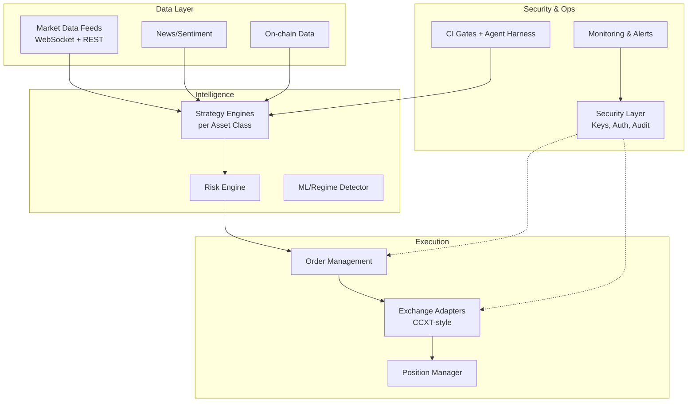

# Automated Cryptocurrency Trading Information System

> Secure, modular framework for multi-asset-class crypto trading with integrated cyber/data security architecture and AI-agent harness practices.

[](https://github.com/kkzee92/crypto-trading-secure-system/actions)
 

## Overview

This repository provides a production-oriented architecture and reference implementation for an **automated cryptocurrency trading information system**. It covers:

- Multi-asset-class trading strategies (Spot, Futures/Perpetuals, Options, DeFi/Yield, Stablecoins, Altcoins)
- Cybersecurity and data security architecture (key management, secrets, encryption, access control, audit trails)
- Risk management, execution, backtesting, and monitoring
- AI coding-agent harness with CI security gates (inspired by best practices from agent safety demos)
- Fail-closed design, paper/simulation modes by default

**Disclaimer:** This is educational/reference code. Cryptocurrency trading involves substantial risk of loss. Not financial advice. Use at your own risk. Always test thoroughly in paper/simulation mode. Comply with local regulations.

## Asset Class Strategies

| Asset Class | Primary Strategies | Key Enhancements |
|-------------|--------------------|------------------|
| **Spot** | Momentum, Mean Reversion, DCA, Grid | Volatility-adjusted sizing, regime detection |
| **Futures/Perps** | Funding rate arb, Trend following, Basis trading | Liquidation risk controls, funding-aware entry |
| **Options** | Volatility selling, Delta-neutral, Covered calls | Greeks monitoring, IV rank filters |
| **DeFi/Yield** | Liquidity provision, Yield farming, Arbitrage | Impermanent loss hedging, smart contract risk scores |
| **Stablecoins** | Peg monitoring, Depeg arb, Yield optimization | Reserve transparency checks, redemption risk |
| **Altcoins** | Momentum rotation, Narrative tracking | Liquidity filters, correlation to BTC/ETH |

See [docs/trading-strategies.md](docs/trading-strategies.md) for detailed strategy specifications and enhancements.

## Security Architecture Highlights

- **Secrets Management**: Environment variables + external vault (HashiCorp Vault / AWS Secrets Manager patterns); never in code or git
- **API Key Security**: IP whitelisting, permission scoping (trade only, no withdraw), rotation policies
- **Encryption**: At-rest (AES-256) for sensitive configs; in-transit TLS 1.3+
- **Access Control**: Role-based (trader, risk-manager, auditor); MFA for critical ops
- **Audit & Monitoring**: Immutable logs, anomaly detection on order flow, gitleaks + secret scanning in CI
- **Fail-Closed**: Paper trading default; live mode requires explicit gated approval
- **Supply Chain**: Dependabot, licence allow-list, pinned dependencies

Full details in [docs/security-architecture.md](docs/security-architecture.md).

## System Architecture



See [docs/architecture.md](docs/architecture.md) for the full design.

## Quick Start (Paper Mode)

```bash
python3 -m venv .venv && source .venv/bin/activate
pip install -r requirements.txt
python -m crypto_trading demo --asset-class spot --mode paper
```

## AI-Agent Harness

This project adopts agent-safety practices:
- `AGENTS.md` defines rules for AI coding assistants
- CI gates: lint, tests, secret scanning, licence checks
- Human review required for merges
- AI-disclosure trail

See `AGENTS.md` and `.github/workflows/`.

## Contributing & Security

- Report vulnerabilities privately via GitHub Security Advisories
- Follow the review checklist
- No production secrets or real personal data in the repo

## Licence

MIT © 2026
